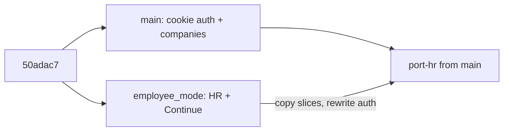
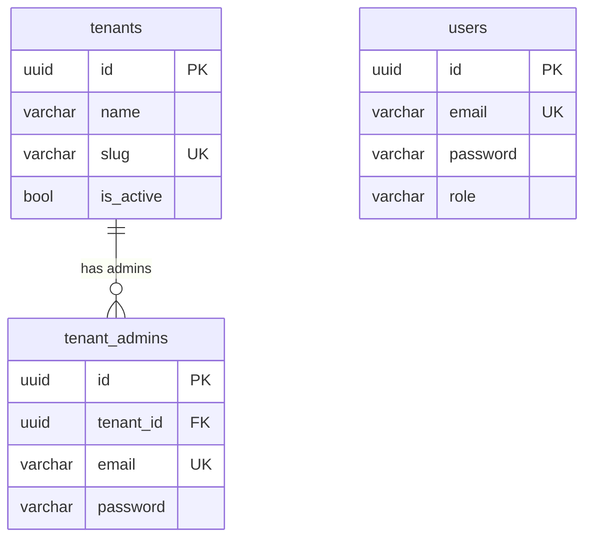
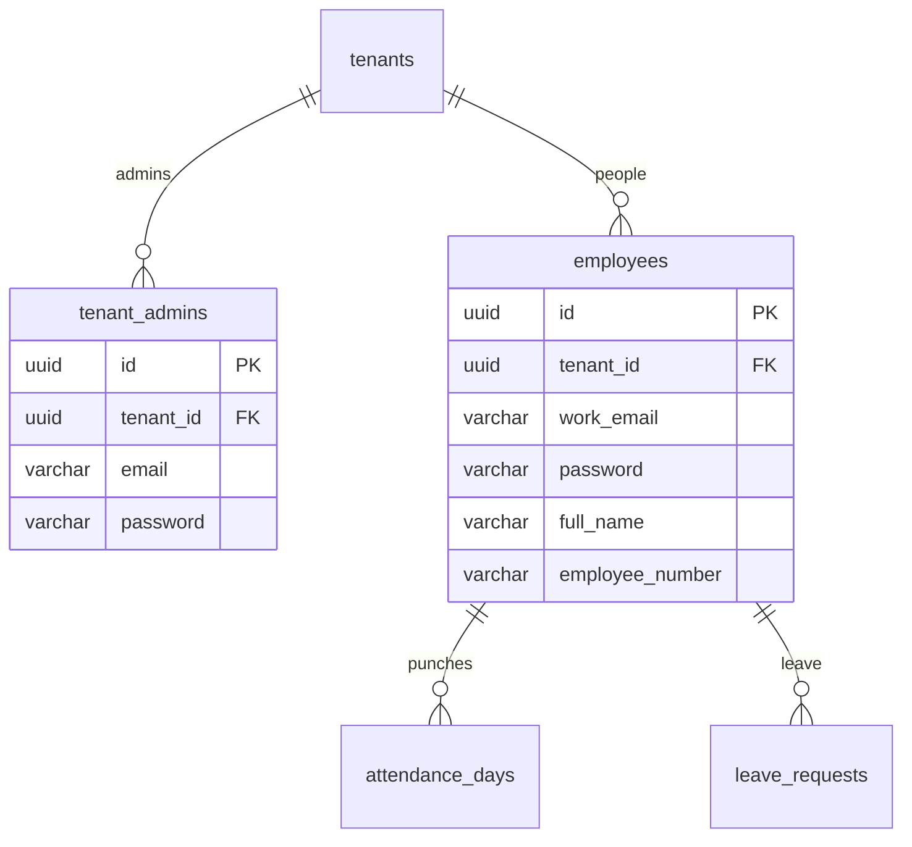
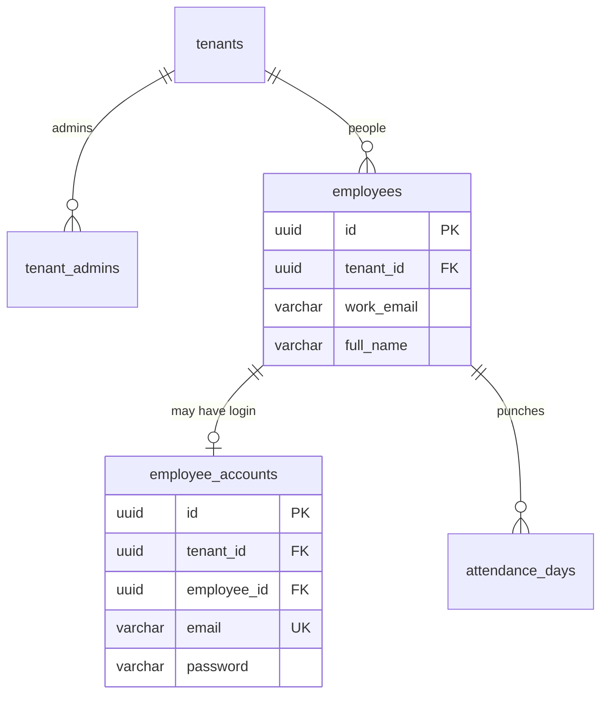
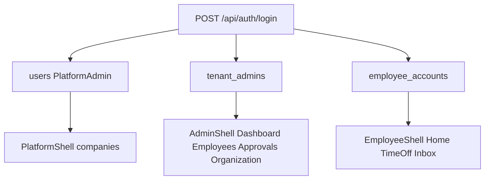

# Port employee and admin onto main

## Why not merge

`main` and `employee_mode` split at `50adac7`. Since then:

- **main** (+3 commits, ~104 files): cookie auth, `User` / `TenantAdmin`, platform tenant CRUD, session `tenant_id`, `EndpointAudience`, Departments dropped.
- **employee_mode** (+9 commits, ~244 files): full employee + admin HR product, still `X-Tenant-Id` + Continue persona stub, no Auth/PlatformTenants.

About 73 files were edited on **both** tips (`TenantContext`, `api-client`, `router`, `AppDbContext`, `DatabaseSeeder`, `ApiFactory`, every migration snapshot, `AGENTS.md`). A merge or commit cherry-pick will fight auth, tenancy, and schema. **Port files onto a branch from `main`.** Use `employee_mode` as a source tree (`git show employee_mode:path`), not as a merge parent.

Working tree is currently on `employee_mode`. Implementation starts with `git checkout main` and a new branch (for example `port-hr`).

## Decisions already made

- **Platform on `main` wins.** Do not reintroduce `X-Tenant-Id`, `Tenancy:DefaultTenantId`, or a second tenant resolver. `TenantContext.ResolveFromRequest` stays the only mapping.
- **Real Employee identity.** Separate logins, not Continue. No persona switcher.
- **Phased cut** (recommended below) so R&D can be dropped without boiling the ocean.

## Database tables — what exists vs the password choice

Two branches, two schemas. The port starts from **main**. HR tables are copied from `employee_mode`. The only open identity question is where the employee password lives.

### On `main` today (platform — keep)

Three tables. Login already knows how to search the first two identity tables.

- `users` — platform owner only (`Role = PlatformAdmin`). **Not** tenant-scoped. Seeded `owner@cloudesh.test`.
- `tenants` — company registry. **Not** `ITenantScoped`. Created by the platform admin. Must not be exposed as a tenant-facing HR endpoint.
- `tenant_admins` — org admin login. **Is** `ITenantScoped`. Email + password on the **same row**. Email unique platform-wide so login needs no tenant picker.

There is no `employees` table on `main`.

### On `employee_mode` today (HR — port, no logins)

`tenants` still exists but is the old hardcoded-demo shape. No `users`, no `tenant_admins`, no passwords anywhere. `employees` is HR only (`work_email`, no `password`). `is_admin` is a Continue-era flag, not a login.

Other HR tables (all `ITenantScoped`, all FK to `employees.id` except holidays/org):

- `employees` — person: name, number, work email, title, department name, location, manager, started on, hours, working days, timezone, emergency contact, employment type, phone, team, desk, status, **is_admin**
- `attendance_days`, `leave_allowances`, `leave_requests`, `punch_corrections` — point at `employee_id`
- `company_holidays`, `organization_profiles` — one set per tenant
- `departments` — walking skeleton; **do not port** (already dropped on `main`)

### Option A — password on `employees` (same pattern as `tenant_admins`)

Add one column (and drop `is_admin`). Login grows a third lookup: `users` → `tenant_admins` → `employees.work_email` + `employees.password`.

Session `NameIdentifier` = `employees.id`. `/me` loads that row. Disable login later by clearing/flagging `password`; **do not delete** the employee (attendance/leave keep the FK).

### Option B — new `employee_accounts` (what the first draft asked for)

`employees` stays password-free. A second login table points at the person, the way `tenant_admins` points at `tenants` — except here the “person” already has its own table.

Session `NameIdentifier` = `employee_accounts.id`. `/me` joins to `employees`. You can have a roster row with no login, or delete the account row when someone leaves.

### Same in both options

- `users` and `tenant_admins` stay as they are on `main`
- Emails stay unique across `users` + `tenant_admins` + employee login email (work email or account email)
- Same human as admin and employee ⇒ two emails (login has no role picker)
- Attendance/leave still FK to `employees.id`, never to a login id

### What actually differs

- **Option A:** one new column on a table we must add anyway. Matches how `tenant_admins` already works. Login code is a copy of the tenant-admin branch.
- **Option B:** one extra table + extra join on every `/me` and punch. Only pays off if we need “employee exists but cannot log in yet” as a first-class state, or we want to delete credentials without touching the HR row.

The first draft picked B because the architecture note says “records must outlive login.” Option A also does that (keep the employee, disable the password). B is not required for that sentence.

## Recommended defaults (confirm or change)

These are the remaining product calls. The plan assumes them unless you say otherwise.

1. **Employee login is Option B.** New `employee_accounts` (email, password, `employee_id`). `employees` stays an HR row with no password. Drop `Employee.IsAdmin`. Session `NameIdentifier` = `employee_accounts.id`.
2. **Create employee creates a login.** Tenant admin supplies work email + password (same shape as [CreateTenantAdmin](backend/src/Cloudesh.Application/Features/PlatformTenants/CreateTenantAdmin.cs)). Insert `employees` then `employee_accounts` (account email = work email unless we later split them). Extend [PlatformEmailUniqueness](backend/src/Cloudesh.Application/Features/PlatformTenants/PlatformEmailUniqueness.cs) so emails stay unique across platform admins, tenant admins, **and** employee accounts. Same human as admin + employee ⇒ two emails.
3. **No hardcoded Acme tenant.** Platform still creates companies. Do not restore `DefaultTenantId` or auto-seed an August 2026 roster into every tenant. Tests build their own employees. A later optional `make seed-demo` can exist; it is out of scope for the first three PRs.
4. **Drop the frozen clock.** Delete `EmployeeAppClock` and `demo-session.ts`. Use `TimeProvider` and real “today”. UX HTML kits stay design reference, not live fixtures.
5. **`GET /api/employees/me` is the signed-in employee.** Look up `employee_accounts` by session id, then the linked `employees` row. Never prefer `EMP-1024`. Tenant admin calling `/me` is 403.

## Keep / drop / rewrite

**Copy wholesale (docs + pixels)**

- [docs/ux-admin/](docs/ux-admin/) — missing on `main`
- Updated [docs/ux-employee/](docs/ux-employee/) (including punch-log)
- Shared UI from the branch: `page-title`, `progress-bar`, `sheet-panel`, `status-dot`, `badge`, `textarea`, admin chrome bits, `mushroom-avatar.svg`
- Feature **page and component** implementations (calendars, punch sheets, approval drawer, add-employee dialog) after stripping `demo-session` / store imports

**Port and adapt (high value)**

- Domain: `Employees`, `Leave`, `Attendance`, `Holidays`, `Organization`, `Approvals/PunchCorrection`
- Features: `Employees`, `Leave`, `Attendance`, `Inbox`, `Approvals`, `Dashboard`, `Organization`, `Holidays`
- Isolation + endpoint tests (rewrite harness to cookie login)
- Frontend `features/{attendance,leave,inbox,employees,approvals,dashboard,organization}` API modules and query keys (cookie `api-client`, per-feature key factories)

**Throw away (R&D / fights `main`)**

- `frontend/src/lib/session-stub.ts`, `continue-page.tsx`, `session-gate.tsx`
- `frontend/src/lib/demo-session.ts`, `employee-app-store.ts`, `employee-query-keys.ts`
- `frontend/src/test/employee-app-api-mocks.ts`, `admin-app-api-mocks.ts`, global Vitest API mocks
- `EmployeeAppClock`, `CurrentEmployee` EMP-1024 fallback
- Walking-skeleton `Departments` (already gone on `main` — do not bring it back)
- Header tenancy in `api-client.ts` / `env.ts` / `TenantContext`
- `employee_mode` migrations and `AppDbContextModelSnapshot` — **rebase one new migration per phase on `main`’s snapshot**
- `employee_mode` AGENTS / ARCHITECTURE / ADD-A-FEATURE wording (Continue, header tenant, one hardcoded company). Merge HR nav rules **into** `main`’s platform docs

**Never revert on `main`**

- `Features/Auth`, `Features/PlatformTenants`, `Domain/Identity`
- Cookie `api-client`, `session-layout.tsx`, `mode-shell.tsx` (extend, don’t replace)
- Session-claim `TenantContext`

## Authorization on the existing pipeline

[EndpointAudience.Tenant](backend/src/Cloudesh.Application/Common/Endpoints/EndpointAudience.cs) today means “signed-in **tenant admin**.” Widen it to “authenticated + `tenant_id` claim” so employees share the tenant filter.

Add role filters (do not add a second tenant resolver):

- `RequireTenantAdminEndpointFilter` — list/create/update employees, dashboard, approvals, organization, any-employee calendar/leave
- `RequireEmployeeEndpointFilter` — `/employees/me`, own attendance, own leave, inbox
- Mixed groups (`EmployeeEndpoints`) apply filters **per route**, not on the whole group

[Login](backend/src/Cloudesh.Application/Features/Auth/Login.cs) grows a third lookup after `User` and `TenantAdmin`: `EmployeeAccount` with `IgnoreQueryFilters([TenantIsolationFilter])`, then sign in with `UserRoles.Employee` + `tenant_id`. Inactive company still 403.

[GetCurrentUser](backend/src/Cloudesh.Application/Features/Auth/GetCurrentUser.cs) already returns `role`; frontend routes on that.

## Frontend shells

Extend [session-layout.tsx](frontend/src/app/layout/session-layout.tsx):

| Role | Shell | Nav |
|------|--------|-----|
| `PlatformAdmin` | existing `PlatformShell` | Companies |
| `TenantAdmin` | port `admin-shell.tsx` (replace placeholder `TenantShell` / `TenantHomePage`) | Dashboard / Employees / Approvals / Organization |
| `Employee` | port `app-shell.tsx` | Home / Time off / Inbox (+ Profile / Help if the UX kit still has them) |

Wrong-role URLs redirect (`/admin` as employee → `/`, employee routes as admin → `/admin` or `/`). No `/continue`. Login stays the only unauthenticated page.

Replace `demo-session` labels with `useCurrentUser()` (`tenantName`, `email`) and `useCurrentEmployee()` for the employee chrome.

Frontend tests mock each feature’s `*-api` module (existing convention). Do not port the 621-line in-memory store.

## Phase 1 — Identity, directory, shells

Smallest shippable “both apps exist.”

**Backend**

- `Domain/Employees/Employee` (drop `IsAdmin`)
- `Domain/Identity/EmployeeAccount` + `UserRoles.Employee`
- Login + uniqueness + `/me` from session
- Admin `GET/POST /employees`, `GET/PATCH /employees/{id}` (no leave/attendance nested routes yet)
- One migration `AddEmployeesAndAccounts` generated **from main**
- Isolation tests + authz tests (employee cannot list roster; tenant admin cannot `/me`; cross-tenant invisible)

**Frontend**

- Copy `docs/ux-admin`
- Role routing + two HR shells
- Admin employees list/create/edit (add password field)
- Employee home as a short “signed in as {name}” placeholder (or Profile only)
- Update `AGENTS.md`, `ARCHITECTURE.md`, `ADD-A-FEATURE.md`, both coding-convention docs: delete Continue / header / EMP-1024 / Departments skeleton; document three roles and two HR shells

**Done when:** platform admin creates a company + tenant admin; that admin creates an employee with a password; that employee logs in and sees the employee shell; isolation tests pass.

## Phase 2 — Employee time (attendance, leave, inbox)

Port from `employee_mode` with `CurrentEmployee.GetAsync` rewritten to session, and `EmployeeAppClock` replaced by `TimeProvider`.

- Domain + slices: Leave, Attendance, Holidays, Inbox
- Nested admin reads can wait for Phase 3 (`GET /employees/{id}/leave|attendance`) if they only serve the employee detail tabs
- Employee pages: home (calendar + punch), time-off, request detail, inbox, profile
- Isolation tests for leave/attendance; frontend page tests against mocked APIs

**Throw away in this phase:** punch/leave data that exists only to match 20 Aug 2026 screenshots. Keep the UI.

## Phase 3 — Admin operations

- Dashboard, Approvals (leave + punch corrections), Organization profile
- Employee detail: calendar + leave tabs
- `OrganizationProfile` as a **tenant-scoped companion** to `Tenant` (do not put workplace fields on the platform `Tenant` registry). Replace `CreateAcme()` with defaults from the session company name; plan/seat fields stay read-only
- Isolation tests for dashboard/approvals/org

## Conflict-avoidance checklist (every PR)

- Branch from latest `main`; copy files; never `git merge employee_mode`
- New `IEndpointGroup` types declare `Audience = EndpointAudience.Tenant` (branch groups omit this)
- No `TenantId` assignment, no redundant tenant `Where`, named `IgnoreQueryFilters` only
- Frontend: cookies only, no `VITE_DEV_TENANT_ID`
- Migrations: `make migrate-add` on the port branch; do not copy `AddEmployees` / `AddLeaveAndAttendance` / `AddAdminMode` from `employee_mode`
- Seeder: keep platform-admin seed; do not replace it with the Acme HR seeder
- `make lint && make test && make test-integration` per phase
- Browser-check each new shell (login → correct chrome → one write path)

## Suggested PR sequence

Three PRs, each mergeable alone. Do not land a giant port-hr dump.
