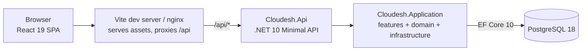
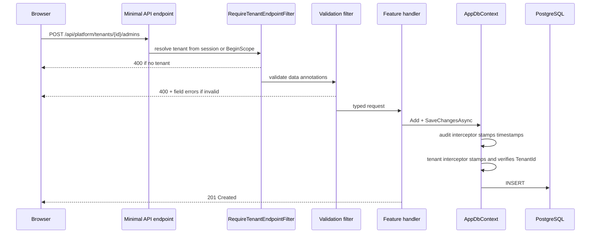
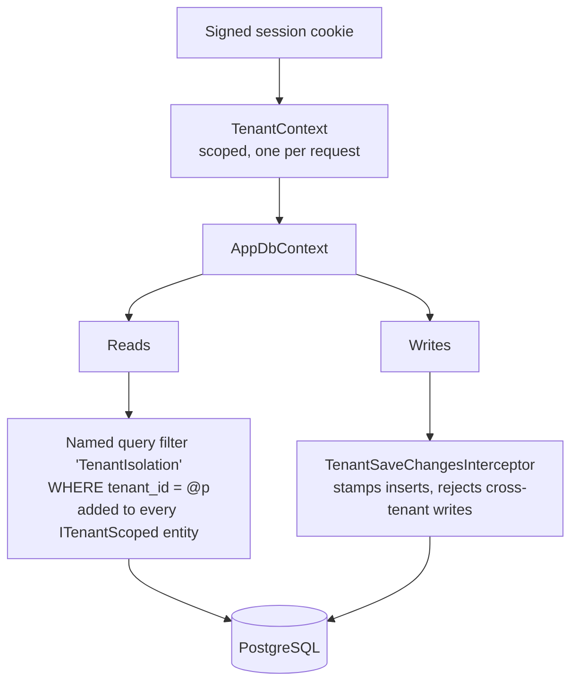
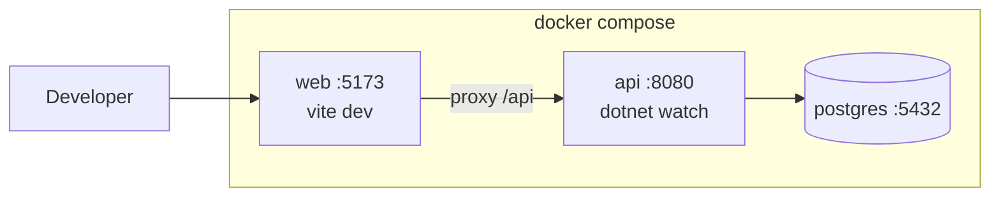

# Architecture

Two documents in one: what exists today, and what has to be added as the product grows.
Read the first half before writing code, and the second half before deciding *where* new
code goes.

- [Part 1: what exists today](#part-1-what-exists-today)
- [Part 2: the roadmap](#part-2-the-roadmap)

---

## Part 1: what exists today

### The shape of the system



The SPA and the API are always served from the same origin — by the Vite dev proxy
locally, by nginx in the Compose production image, and by Kestrel (`wwwroot`) on
Render. That is a deliberate choice: it removes CORS configuration, removes preflight
round-trips, and means no absolute API URL is ever baked into the JavaScript bundle at
build time.

### Why these choices

| Decision                                                | Reason                                                                                                                                            |
| ------------------------------------------------------- | ------------------------------------------------------------------------------------------------------------------------------------------------- |
| Shared database with a `TenantId` column                 | A tenant here is a company with a handful of employees. One database per tenant would multiply operational cost by the number of customers.        |
| Vertical slices instead of layers                        | A feature request touches one folder. Layered code makes the same change span four projects, and the layers rarely earn their indirection.         |
| No repository layer                                      | EF Core's `DbSet` already is one. A repository on top of it either leaks `IQueryable` (achieving nothing) or blocks legitimate query shapes.       |
| Two projects, not four                                   | The API project is a composition root and nothing else. A compile-time boundary between "application" and "infrastructure" is not worth two more projects at this size. |
| Minimal API over controllers                             | Endpoints are one method with explicit dependencies, which suits one-endpoint-per-slice and reads better than attribute routing.                    |
| TanStack Query owns server state                         | Caching, deduplication, and revalidation are its job. Router loaders would create a second cache with its own staleness rules.                     |
| PostgreSQL                                               | Cheap, boring, and its row-level security is a future hardening option if tenant isolation ever needs enforcing below the application.             |

### Backend structure

```
backend/src/Cloudesh.Application/
├── Common/                  # cross-cutting primitives, kept small on purpose
│   ├── Endpoints/           # IEndpointGroup, auto-registration, tenant guard
│   ├── Errors/              # exception to ProblemDetails mapping
│   ├── Pagination/          # PagedResult<T>
│   └── Time/                # employee timezone clock, working-day labels
├── Domain/                  # entities; no EF or HTTP types
│   ├── Common/              # ITenantScoped, IAuditable
│   ├── Attendance/
│   ├── Employees/           # HR person record (no password)
│   ├── Holidays/
│   ├── Identity/            # User, TenantAdmin, EmployeeAccount
│   ├── Leave/
│   └── Tenants/
├── Features/                # one folder per feature — where new code goes
│   ├── Auth/                # login, logout, current session
│   ├── Attendance/          # employee punch, calendar, stamps
│   ├── Employees/           # /me plus admin list/create/update
│   ├── Holidays/            # tenant closed days
│   ├── Inbox/               # derived employee feed
│   ├── Leave/               # balances and requests
│   └── PlatformTenants/     # company + tenant-admin CRUD
├── Infrastructure/
│   ├── Auth/                # cookie session claims, platform-admin options
│   ├── Persistence/         # AppDbContext, configurations, interceptors, seeding
│   └── Tenancy/             # ITenantContext and how the tenant is resolved
└── Migrations/
```

`Common/` is deliberately thin. The rule is three: extract shared code when a third
feature needs it, not when a second one does. Two features sharing a premature
abstraction is how a monolith becomes hard to change.

### Request lifecycle



Both cross-cutting checks are pipeline concerns, so no handler contains tenancy or
validation code. That is the point: the things that must never be forgotten are the
things no one has to remember.

### Tenant isolation

This is the part to understand before anything else, because it is the one whose failure
mode is a customer seeing another customer's payroll.

Isolation is opt-out rather than opt-in. An entity that implements `ITenantScoped` is
isolated automatically; nothing has to be registered or configured per entity.



Reads and writes need separate mechanisms because **query filters do not apply to
writes**. Without the interceptor, a caller who obtained another tenant's primary key
could update or delete that row even though they could never read it.

Four rules follow, and all four are covered by tests in
`backend/tests/Cloudesh.UnitTests/Persistence/TenantIsolationTests.cs`:

1. An unresolved tenant matches zero rows, never all rows. The filter compares against
   `Guid.Empty` rather than `NULL` so this holds without relying on SQL null semantics.
2. Inserts leave `TenantId` unset and let the interceptor fill it in. Setting it to
   another tenant is refused.
3. Updates and deletes of another tenant's row are refused, and surface as **404**
   rather than 403 — a 403 would confirm that the id exists somewhere.
4. `TenantId` is immutable. Rewriting it, even to the current tenant, is refused.

`IgnoreQueryFilters()` with no arguments removes tenant isolation along with everything
else. Always name the filter to disable, and treat a bare call as something that needs a
comment explaining why it is safe.

### Authentication (MVP)

A signed HttpOnly cookie is the session. Passwords are stored and compared in plaintext
for this MVP only.

`TenantContext.ResolveFromRequest` in
[backend/src/Cloudesh.Application/Infrastructure/Tenancy/TenantContext.cs](../backend/src/Cloudesh.Application/Infrastructure/Tenancy/TenantContext.cs)
reads the `tenant_id` claim from `HttpContext.User`. Platform admins have no tenant.
That method is the only place that decides how a request maps onto a company — do not
add a header or a default tenant.

`IEndpointGroup.Audience` splits routes:

- `Anonymous` — `/api/auth/*`
- `Platform` — `/api/platform/*`, requires the platform-admin role
- `Tenant` — `/api/*`, requires a tenant claim (tenant admin or employee)

Role filters on individual routes split tenant-admin roster work from
`GET /api/employees/me`. The session `NameIdentifier` for an employee is the
`employee_accounts.id`; `/me` joins to the `employees` row.

Platform handlers that write `ITenantScoped` rows (tenant admins) wrap the work in
`ITenantScopeFactory.BeginScope`. That is the documented exception to "handlers do not
choose their own tenant".

### Data conventions already in force

- **Primary keys are UUIDv7** (`Guid.CreateVersion7()`), assigned by a static `Create`
  factory on the entity rather than by the database. Time-ordered, so inserts land at the
  right edge of the index instead of scattering across it, and an id exists before the
  row is saved.
- **Timestamps are `DateTimeOffset`** mapped to `timestamptz`, always UTC. Local times
  never enter the database; the browser formats for the viewer.
- **Columns are snake_case** via `EFCore.NamingConventions`, so `psql` sessions and
  hand-written SQL never need quoted identifiers.
- **Unique indexes lead with `TenantId`**, which matches how every query filters and
  doubles as the index EF would otherwise create for the tenant foreign key.

### Local environment



`docker-compose.yml` describes a production-like stack; `docker-compose.override.yml`
switches both application services to their `development` build target with the source
bind-mounted. `docker compose up` applies both.

`Database:MigrateOnStartup` and `Database:SeedOnStartup` are on in development only.
Applying migrations from application startup does not survive contact with more than one
replica — see [Deployment](#deployment-and-operations).

---

## Part 2: the roadmap

Ordered so that each phase can ship on its own. Items marked **blocking** are
prerequisites for most of what follows.

### Phase 1 — Identity and tenancy (blocking)

Nothing meaningful can be built for real users first.

- **Authentication.** Cookie sessions and plaintext passwords are the MVP. Replace them
  with ASP.NET Core Identity plus short-lived JWTs and rotating refresh tokens before
  any real deployment. Reach for an external identity provider only when SSO or SCIM
  becomes a sales requirement — the abstraction to make that swap cheap already exists
  in `ITenantContext`.
- **Tenant onboarding.** Platform-admin company and tenant-admin CRUD exists. Self-serve
  sign-up and invitation email are still ahead. Those endpoints have no tenant, so they
  stay on `EndpointAudience.Anonymous` or `Platform`.
- **Roles and permissions.** Owner, HR Admin, Manager, Employee. Two questions that are
  distinct and both need answering: does this role have the capability, and is this
  record within the person's scope (their own record, their direct reports, everyone)?
  Manager-scoped access is the case that catches teams out, because it depends on the org
  chart rather than on the role alone.
- **A user–tenant join table.** An accountant or consultant may belong to several
  companies, so a user cannot own a single `TenantId`.
- **Audit log.** Extend `IAuditable` with `CreatedBy`/`UpdatedBy`, and add an append-only
  log of who changed what. HR data is exactly the kind that gets disputed later.

### Phase 2 — Core HR

- **Employee records.** Personal details, contact information, emergency contacts,
  identifiers, and the employment relationship. Deciding early whether an employee is the
  same entity as a user account, or a separate record that may or may not be linked, saves
  a painful migration: people leave and their records must outlive their login.
- **Org structure.** Departments (already scaffolded), teams, positions, and reporting
  lines. Reporting lines form a graph, and a manager's scope is derived from it, so query
  performance here affects every permission check.
- **Employment contracts with effective dating.** See [Effective dating](#effective-dating).
- **Documents.** Contracts, certificates, ID scans. Needs object storage — see
  [File storage](#file-storage).
- **Onboarding and offboarding checklists.** Templates, assignees, due dates.

### Phase 3 — Time and absence

The first area with real business rules, and the first place a workflow engine earns its
keep.

- **Leave types and policies:** accrual rate, carry-over caps, probation rules,
  pro-rating for part-time staff, and which policy applies to whom.
- **Balances and accrual.** Recompute on demand from a ledger of accrual and consumption
  events rather than storing a mutable number. A stored balance drifts, and when a
  customer disputes it there is no way to explain how it got there.
- **Requests and approvals.** A state machine with an audit trail, plus delegation for
  when an approver is themselves on leave.
- **Holiday calendars,** per country and region. Even a five-person company may be
  distributed.
- **Attendance and timesheets:** clock-in/out, corrections with an approval trail,
  overtime.

### Phase 4 — Payroll and compliance

The highest-risk area: wrong output means someone is underpaid.

- Salary structures and components (base, allowances, deductions).
- Payroll runs: draft, review, approve, lock. A locked run must be immutable, and
  corrections must be a new adjusting run rather than an edit.
- Payslip generation and distribution.
- Statutory deductions and filings, which are jurisdiction-specific and change annually —
  keep the rates as versioned, effective-dated data, never as constants in code.
- Export to accounting software.

### Phase 5 — Platform capabilities

Needed at different points; listed together because they are all cross-cutting.

#### Background jobs

Accruals, payroll runs, reminders, and report generation cannot happen inside a request.
Start with a `BackgroundService` plus a database-backed queue; move to Hangfire or Quartz
when scheduling, retries, and a dashboard are worth a dependency. Jobs run outside a
request, so they must open a tenant scope explicitly via `ITenantScopeFactory` — the
mechanism the seeder already uses.

#### Domain events and the transactional outbox

The moment "approve leave" also has to send an email and update a balance, side effects
need to survive a crash between the database commit and the side effect. Write events to
an `outbox` table in the same transaction as the state change, and dispatch from there.

#### Notifications

Transactional email (a provider such as Postmark or SES), in-app notifications, and
per-user preferences. Templates belong in the repository, not in the provider's UI, so
they are reviewable and versioned.

#### File storage

S3-compatible object storage, never the database and never the container filesystem.
Uploads and downloads go through pre-signed URLs so file bytes never pass through the API,
and every object key must be prefixed with the tenant id.

#### Caching

Redis, when there is a measured problem. Cache keys must include the tenant id — a cache
is the easiest place to accidentally undo tenant isolation, because nothing in Redis
applies a query filter.

#### Observability

Structured logging (Serilog or `Microsoft.Extensions.Logging` with a JSON formatter) with
the tenant id and correlation id on every entry, OpenTelemetry traces and metrics, and
error tracking (Sentry). `/health` is liveness (process up). `/health/ready` includes the
database check. Render’s deploy probe uses `/health` so a cold Neon compute
does not fail the roll-out.

#### API surface

- **Versioning.** Introduce `/api/v1` before there is an external consumer, not after.
- **Rate limiting.** `AddRateLimiter`, per tenant rather than per IP.
- **Idempotency keys** on mutating endpoints, which is also the prerequisite for enabling
  mutation retries in the frontend query client.
- **Cursor pagination** for anything that can grow past a few thousand rows. Deep offsets
  make the database count past every skipped row.

#### Data protection and compliance

- Export and erasure per data subject (GDPR articles 15 and 17). Erasure interacts badly
  with payroll retention obligations, so design for anonymisation rather than deletion.
- Field-level encryption for sensitive identifiers.
- Data residency, if selling into the EU or UK, which is the one requirement that could
  force a move to database-per-region.

#### Billing

Per-seat subscriptions through Stripe, with webhook-driven state, dunning, and grace
periods. Seat counts derive from active employees, so the definition of "active" becomes a
billing concern as well as an HR one.

#### Internationalisation

- **Timezones.** Store UTC, render local. Leave and attendance are the hard cases: a
  full-day leave request is a calendar date, not an instant, and must not shift because the
  viewer is in another timezone.
- UI translation and locale-aware formatting of dates, numbers, and currency.

### Deployment and operations

The first production target is **Render + Neon**. See [DEPLOY-RENDER.md](DEPLOY-RENDER.md).
The root `Dockerfile` publishes the API and copies the SPA into `wwwroot`, so the
browser talks to one origin. `DATABASE_URL` is the Neon URI; `ConnectionStrings:Default`
stays the local Compose form.

- **Migrations as a deploy step.** The chiseled image has no shell, so Render cannot run
  `dotnet ef` as a pre-deploy command. A single Render instance may set
  `Database:MigrateOnStartup` (and Neon’s pooler host is rewritten to the direct host
  before `MigrateAsync`). Turn the flag off and run migrations as their own job before
  adding a second replica — two instances starting together will otherwise race.
- **CI.** Build, test, lint, and build images on every pull request. Add an
  architecture-fitness test that fails if an entity is added without `ITenantScoped`.
- **Secrets** from the platform's secret store (`render.yaml` `sync: false` env vars),
  never from `.env`, which exists purely for local development.
- **Backups.** Neon’s automated backups plus point-in-time recovery, and a restore
  that has actually been tested. An untested backup is a hypothesis.
- **Non-root hardened images.** The API and the Render image use a chiseled base with no
  shell. The Compose nginx image still runs its master process as root; switch to
  `nginxinc/nginx-unprivileged` when hardening that path.

---

## Cross-cutting patterns to adopt as features land

Each of these is cheap to introduce with the first feature that needs it and expensive to
retrofit across twenty.

### Soft delete

HR records are rarely truly deleted. Add `ISoftDeletable` and register a *second* named
query filter alongside `TenantIsolation`:

```csharp
modelBuilder.Entity<TEntity>()
    .HasQueryFilter(QueryFilters.SoftDelete, entity => !entity.IsDeleted);
```

Named filters are why the tenant filter has a name today. A "view trash" screen can then
disable exactly one guarantee:

```csharp
dbContext.Employees.IgnoreQueryFilters([QueryFilters.SoftDelete]);  // tenant isolation intact
```

### Effective dating

Salary, position, and contract are not single values; they are values with a validity
period. Model them as rows with `ValidFrom`/`ValidTo` so "what was this person's salary
last March" is answerable, and so a raise can be entered before it takes effect.

This is the single most expensive thing to retrofit, because it changes the shape of every
query that touches the affected entity. Decide it when employee records are designed, not
after.

### Workflow state machines

Leave requests, onboarding, and payroll runs all have states with legal transitions.
Encode the transitions in one place per workflow and reject invalid ones there, rather
than scattering status checks through handlers.

### Optimistic concurrency

Add a concurrency token (`xmin` on PostgreSQL) to anything two people might edit at once.
Without it, the second save silently overwrites the first.

### Multi-tenancy hardening

If tenant isolation ever needs to hold even against a bug in application code, PostgreSQL
row-level security enforces it in the database: set the tenant per connection and let RLS
policies filter. It costs a connection round-trip per request and complicates connection
pooling, which is why it is not the starting point — but the `TenantId` column and the
`ITenantContext` seam are exactly what an RLS migration would need.
