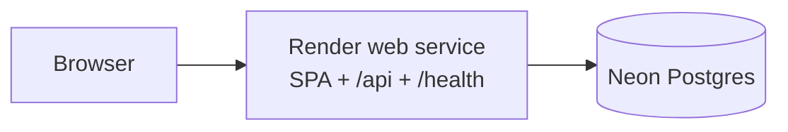

# Deploy to Render + Neon

One public origin on Render, Postgres on Neon. The session cookie stays
same-site because the API serves the built SPA from `wwwroot`.



## 1. Create the Neon project

1. Open [console.neon.tech](https://console.neon.tech) and create a project.
2. Pick the same region you will use on Render (Oregon ≈ `us-west`, Frankfurt ≈ `eu-central`, etc.).
3. Copy a connection string:
   - **Direct** (no `-pooler` in the host) is the one to paste as `DATABASE_URL`.
   - The pooled URL also works for queries; the app rewrites the host before
     applying migrations. Set `DATABASE_URL_UNPOOLED` if you want that rewrite
     to be explicit.

Neon requires TLS. The app adds `SSL Mode=Require` when the host is `*.neon.tech`
and the string did not already ask for a stricter mode.

Leave Neon’s IP allow-list open unless you pay for Render static outbound IPs —
Render’s egress addresses change.

## 2. Blueprint from this repo

The repo root [`render.yaml`](../render.yaml) is the Blueprint.

1. Push the branch you want to deploy.
2. In Render: **New → Blueprint**, pick this repository.
3. When prompted, set:

   | Variable | Value |
   | -------- | ----- |
   | `DATABASE_URL` | Neon connection string |
   | `DATABASE_URL_UNPOOLED` | Direct Neon URL, or the same as `DATABASE_URL` |
   | `PlatformAdmin__Email` | First sign-in email |
   | `PlatformAdmin__Password` | First sign-in password |

4. Deploy. First boot applies EF migrations and upserts that platform admin.

The image is the root [`Dockerfile`](../Dockerfile): Node builds the SPA, the
SDK publishes the API, the chiseled runtime copies `dist` into `wwwroot`.

Render injects `PORT`. The host binds `0.0.0.0:$PORT` and trusts
`X-Forwarded-Proto` so `Secure` cookies work behind Render’s TLS terminator.

## 3. After it is up

- Open `https://<service>.onrender.com` and sign in as the platform admin.
- `/health` is liveness (process up). `/health/ready` also pings Neon.
- Keep **one instance** while `Database__MigrateOnStartup` is true.
- Do not put secrets in `VITE_*` variables — they are baked into the public JS.

## 4. Build the image locally

```bash
make build-deploy
docker run --rm -p 8080:8080 \
  -e DATABASE_URL='postgresql://…' \
  -e Database__MigrateOnStartup=true \
  -e Database__SeedOnStartup=true \
  -e PlatformAdmin__Email=owner@cloudesh.test \
  -e PlatformAdmin__Password=change-me \
  cloudesh-hr:deploy
```

## What this does not do yet

- Persistent data-protection keys — a new deploy mints new cookie-signing keys
  and existing sessions end. Fine for a first ship; add a disk or a key ring
  before you have real users.
- A separate migrate job — required before more than one replica.
- Custom domains — add them on the Render service when you have a DNS name.
